

  

  

 

<picture>
  <source media="(prefers-color-scheme: dark)" srcset="https://raw.githubusercontent.com/cjr23/cjr23/main/assets/title-projects-dark.svg" />
  
</picture>

  <a href="https://cours-bureautique.vercel.app"></a>
  <a href="https://github.com/cjr23/Gestion-Examens-Blancs"></a>

  <a href="https://ceshfpt.vercel.app"></a>
  <a href="https://terangaconsulting.vercel.app"></a>


  Source code: <a href="https://github.com/cjr23/CESHFPT">CESHFPT</a> · <a href="https://github.com/cjr23/terangaconsulting">Teranga Consulting</a> · <a href="https://github.com/cjr23/Gestion-Examens-Blancs">SchoolPro</a>

 

<picture>
  <source media="(prefers-color-scheme: dark)" srcset="https://raw.githubusercontent.com/cjr23/cjr23/main/assets/title-stack-dark.svg" />
  
</picture>


 

<picture>
  <source media="(prefers-color-scheme: dark)" srcset="https://raw.githubusercontent.com/cjr23/cjr23/main/assets/title-contact-dark.svg" />
  
</picture>

  
  
  
  

 

