 
 
 
 
 
 
 
 
 

Source code: <a href="https://github.com/cjr23/CESHFPT">CESHFPT</a> · <a href="https://github.com/cjr23/terangaconsulting">Teranga Consulting</a> · <a href="https://github.com/cjr23/Gestion-Examens-Blancs">SchoolPro</a>

